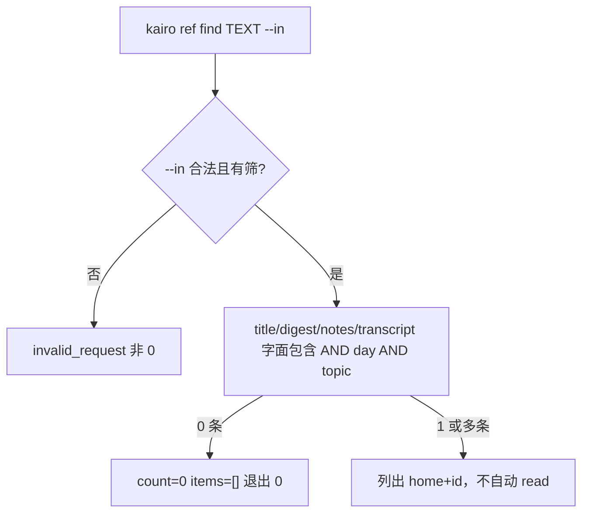

# #445 — `kairo ref find --in` 字面匹配 digest / notes / transcript

- Issue: [#445](https://github.com/xforce-io/kairo/issues/445)
- 分支: `feat/445-ref-find-in`
- 状态: Approved（产品范围由 issue 负责人锁定；本文件为实现事实源）
- 本文件是 #445 的 **L2 事实源**。沿用 [#402](402-ref-find-read.md) 的检索入口与 JSON 形，不新开 `search` / `find` 顶层命令。

## 1. 背景

[#445](https://github.com/xforce-io/kairo/issues/445)。#402 的 `kairo ref find` 只按标题子串、`--day`、`--topic` 过滤。智能体要在 digest / notes / transcript 里找字面内容时没有统一入口。产品口径（peng 2026-10-22）：只保留 `kairo ref find`，加 `--in`，内容先字面匹配；向量 / 语义非目标。

## 2. 名词解释

沿用 [docs/glossary.md](../glossary.md) 的 Ref、digest、notes、transcript。本票不新增名词表条目。

## 3. 目标与非目标

### 3.1 目标

`--in title|digest|notes|transcript|all` 选择字面包含匹配的字段；省略 `--in` 等于 `--in title`；既有 `--title` / `--day` / `--topic` 标题用例命中集合不变。

### 3.2 非目标

新 `search` / `find` 顶层命令；向量 / 语义 / embedding 检索；改 Web `/p/search`；改 Project / Topic 模型；改 JSON item 形；自动 read。

## 4. 能力

### 4.1 UI/UX

N/A。无 Console 新页。用户可见面仍是 CLI。

`kairo ref find --help` 可见 `--in` 与五值闭集。人读输出仍是一行一条 `home id title occurred_at`；零命中 `count 0`。

### 4.2 检索

字面包含、区分大小写，与 #402 标题匹配相同。`--in all` 为四字段 OR。`--day` / `--topic` 仍与字面条件 AND。

查询字串：位置参数与 `--title` 同一槽；同时给出且不相等 → `invalid_request`。`--in` 非 `title` 且无字串 → `invalid_request`。非法 `--in` → `invalid_request`，非 0 退出。缺字段文件 = 该字段空串，不命中。

## 5. 思路与折衷

在现有 `ref find` 上加字段开关，不新命令、不建索引。查询仍走 catalog + 已落盘 form / notes 正文。放弃语义检索与扫内部 `.kairo/state.json`。

## 6. 架构



主路径：find（可选 `--in`）→ 调用方再 `ref read`。实现与测试中 `step` / `run` / `re-step` 次数为 0。

## 7. 模块

| 面 | 变化 |
|---|---|
| `kairo ref find` | 增 `--in` 与可选位置参数 |
| Skill / 功能地图 | 一行说明字段闭集与默认 title |
| `kairo ref read` | **不改** |
| Web `/p/search`、Project/Topic 模型 | **不改** |

## 8. API/CLI

无新 HTTP。`--root` 沿用 serve root。

### 8.1 命令

```
kairo ref find [TEXT] [--title TEXT] [--in title|digest|notes|transcript|all] [--day YYYY-MM-DD] [--topic SLUG] [--json] [--root PATH]
```

`--in` 合法枚举恰好五值，默认 `title`。`--title` 与位置参数是同一字面片段槽。

### 8.2 JSON

成功形同 #402：`ok, count, items[]`（`home,id,title,occurred_at,topics`）。不新增命中字段。

失败：`{"ok":false,"code":"invalid_request","error":"…"}`（非法 `--in`；位置参数与 `--title` 冲突；非 title 且无片段）。其余失败码沿用 #402。

### 8.3 禁令

不引入 embedding / vector / 语义相似度。不把缺文件当成另一字段顶替。帮助与 Skill 不写 `find`/`ls` 扫盘。

## 9. 边界

In/Out 同 issue。不改 Timeline Web。不改 notes 存数。

## 10. 迁移 / 兼容 / 回滚

省略 `--in` 等价 `--in title`。既有 `kairo ref find --title <片段>` 命中集合不变。回滚即去掉本票提交。

## 11. 测试计划

功能地图：`.agents/skills/verify-kairo-web/features/ref-find-read.md`。无 Console Drive。

| 层级 / 验收 | 路径 | 可判定结果 |
|---|---|---|
| E2E S1 | `--in` 五值与 `--help`；非法值 | 合法枚举恰好 5；非法非 0 |
| E2E S2 | 省略 `--in` vs `--in title`；既有 `--title` | 标题用例命中 id 集合一致 |
| E2E S3 | 字段含 S、标题不含 S | `--in title` 不中；对应字段 / `all` 命中；无语义路径 |
| Integration | 上述路径 | step/run/re-step = 0 |

## 12. 开放问题

无。产品范围已由 issue 锁定。

## 13. 关联

- Issue [#445](https://github.com/xforce-io/kairo/issues/445)
- [#402](402-ref-find-read.md) 检索入口
- [#410](410-ref-markdown-notes.md) notes 正文
- [#446](446-ref-matter-package.md) 事项包口径正交，本票不含该定义
