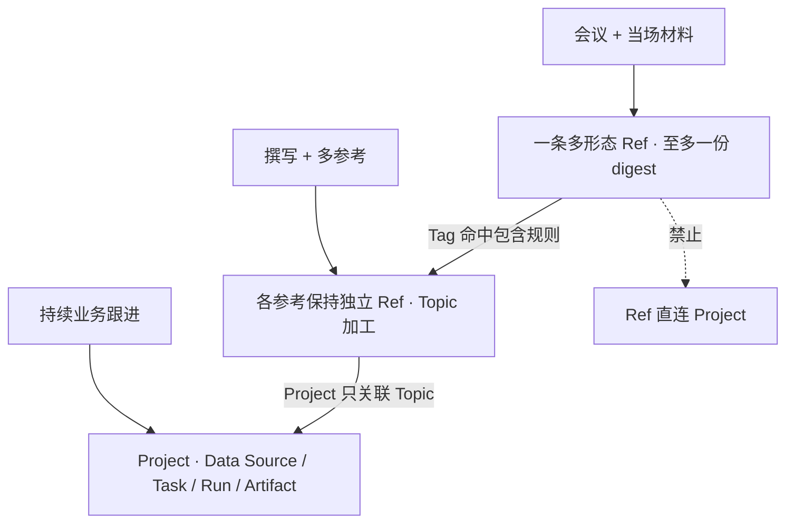
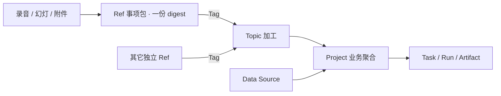

# #446 — Ref = 一次事项的多形态资料包

- Issue: [#446](https://github.com/xforce-io/kairo/issues/446)
- 分支: `feat/446-ref-matter-package`
- 状态: L1 Draft（peng 2026-10-22 口径已确认；本文件待人工批准后方可开实现票。不自批。）
- 日期: 2026-10-22
- 本文件是 #446 的 **L1 事实源**。Issue 只保留摘要与本链接。本票只改名词表与本设计，不改运行时、schema 或 CLI 行为。

## 1. 背景

[#446](https://github.com/xforce-io/kairo/issues/446)。现网 Ref 在用户心智里常被当成「单文件」；引擎侧早已是多形态（[#67](67-dir-as-multiform-ref.md) 目录→一条 Ref 多 forms；[#44](44-meeting-multiform-digest.md) 会议合并一份 digest；[#357](357-ref-details-attach.md) 往既有 Ref 追加形态）。

peng 2026-10-22 确认：把 Ref 明确成「一次事项的多形态资料包」。Project 是更大业务聚合（Data Source / Task / Run / Artifact），不是同一量级，不把 Ref 升级成 / 改名叫 Project，也不合并两套模型。

硬约束沿用 [#242](242-global-ref-topic.md)：Ref 不直连 Project；一条 Ref 至多一份 digest。

## 2. 名词解释

已有 Tag、包含规则、Timeline、digest、stream、corpus、Data Source、Task、Run、Artifact 见 [名词表](../glossary.md)。本票改写三条，不新增 Case / Matter / 事项对象：

| 规范名 | 本票后一句话 | 禁止别称（本票后） |
|---|---|---|
| Ref | 一次事项的多形态资料包：稳定 id、来源、发生时间、若干形态与至多一份 digest；不是单文件，不直连 Project。 | 资料副本、单文件、Project、课题、Case、Matter |
| Topic | 知识加工对象；撰写所用多份参考仍各为独立 Ref，由包含规则进入后加工。 | 课题、保存的筛选器 |
| Project | 更大的业务聚合（Data Source / Task / Run / Artifact），多对多关联 Topic；与一条 Ref 事项包不同量级。 | 课题、工作区组、事项包 |

「形态 / form」沿用 #67 / #44，不新开名词表行。不把 Ref 改名为 Project，也不把 Project 改写成事项包。

## 3. 目标与非目标

### 3.1 目标

- 名词表把 Ref 从「一份资料的全局身份」改成「一次事项的多形态资料包」，并禁止称作 Project / 课题 / 单文件 / Case / Matter。
- 用三类落点写清边界：会议+当场材料 → 一条多形态 Ref；撰写+多参考 → Topic 加工、参考各为独立 Ref；持续业务跟进 → Project。
- 写明复用 #67 / #357（及 #44 一份 digest），指导后续 CLI / Web 文案与能力切开，本票本身不含代码。

### 3.2 非目标

- 不新增 Case / Matter / 事项对象，也不把现有 Ref 改名为其中任一。
- 不改 Project 模型、schema、关联边；不把 Ref 直连 Project。
- 不改 Ref 存储 schema、digest 上限（仍至多一份）、Tag / 包含规则。
- 不做向量 / 语义 / embedding 检索。
- 不含 [#445](445-ref-find-in.md) 的 `ref find --in` 范围（已正交合入）。
- 本票不改运行时、CLI、Web 文案落地或实现新 attach / 目录摄入。

## 4. 能力

本票无新 Console 页、无新命令。能力是**口径与落点**：读者按下面三例决定材料进 Ref、进 Topic 还是进 Project。

### 4.1 会议 + 当场材料 → 一条多形态 Ref

正例：一次会的录音、幻灯、当场附件同属这一次事项，登记为**一条** Ref 的多个形态；digest 仍只有一份。

| | |
|---|---|
| 做法 | `kairo add <dir>`（#67）一次建多形态；或先登记再 `kairo add <file> --to <ref_id>` / Console 附加（#357） |
| 消化 | stream 则对该 Ref 产至多一份 digest，再按 Tag 进入 Topic fold |
| 不做 | 每个文件一条 Ref；为这场会新建 Case/Matter；把这场会升级成 Project |

空：还没有当场文件时不要预建空事项对象。成：目录或 attach 后仍是同一 id。错：把会后另一次事项的材料塞进同一 Ref（那是另一条 Ref）。

### 4.2 撰写 + 多参考 → Topic 加工

正例：写一篇文档、综合多份已有会议 / 纪要 / 基线。参考**保持独立 Ref**；加工面是 Topic（constitution、`understanding.md`、fold）。

| | |
|---|---|
| 做法 | 各参考维持自己的 id / 形态 / digest；用 Tag + 包含规则进入撰写用 Topic；`step` / 单独综合只在 Topic |
| 消化 | 多份 digest 折入该 Topic 活 target；不把参考合并成一条「撰写工程 Ref」 |
| 不做 | 把引用过的资料 attach 进正在写的那条文档 Ref；用 Project Task 代替 Topic 综合 |

空：Topic 无成员时仍是研究上下文，不是缺一个事项包。成：成员列表可见多条独立 Ref。错：为「这篇文章引用了它们」新建容器对象。

### 4.3 持续业务跟进 → Project

反例（相对「把跟进做成一条大 Ref」）：一条业务线要持续读外部源、跑 Task、留 Run / Artifact。这是 **Project**，不是把 Ref 做大。

| | |
|---|---|
| 做法 | Project 关联相关 Topic；资料 = 成员 Ref 并集；工作走 Data Source / Task / Run / Artifact |
| 消化 | Project 不产 Ref digest；知识加工仍在 Topic |
| 不做 | Ref ↔ Project 直连勾选；把 Project 改名叫事项包；把多形态 Ref 改名为 Project |

空：无 Task 仍是 Project。成：概览进 Task / Artifact，材料来自关联 Topic。错：为跟进新建 Case/Matter，或把多条 Ref 合成一条「业务 Ref」。

## 5. 思路与折衷

产品缺口是**叫法与落点**，不是缺一层对象。#67 / #44 / #357 已经能表达「一次事项、多形态、一份 digest」。本票把心智从「单文件」改成「事项包」，并钉死与 Topic / Project 的量级差。

放弃：新建 Case/Matter、把 Ref 升格为 Project、把多参考撰写并成一条 Ref。代价是撰写场景要靠 Topic 成员而不是一个超级 Ref；收益是 #242 的身份、digest 唯一、Project 只联 Topic 都不动。

`ref find --in`（#445）只回答「在哪段正文里找字面」，不定义事项包，故正交、不并入本票。

## 6. 架构

本票无分层改动。读者心智与现网对象对齐如下；实现仍走既有 `kairo.refs` / Topic 包含规则 / Project 关联 Topic。

主路径：当场材料进一条 Ref → Tag → Topic 成员 → 需要持续执行时由 Project 关联该 Topic。失败路径：禁止用新对象或 Ref↔Project 边兜底。

## 7. 模块

本票不改模块。后续实现票若动文案 / 引导，只消费本口径，不得顺手改 schema。

| 面 | 本票 |
|---|---|
| [名词表](../glossary.md) | 改 Ref / Topic / Project 交叉句 |
| 本 L1 | 三类落点与非目标 |
| `kairo.refs` / Project JSON / digest 引擎 | **不改** |
| `kairo ref find --in` | **不改**（#445） |

## 8. API/CLI

N/A。无新 HTTP、无新 CLI、不改 JSON 形。既有摄入与附加保持：

- `kairo add <dir>` → 一条多形态 Ref（#67）
- `kairo add <file> --to <ref_id>` / `POST /refs/{id}/attach` → 追加形态（#357）
- 知识 Run 只在 Topic；Project Task Run 只在 Project（#242）

## 9. 边界

- In：glossary Ref（及 Topic / Project 必要交叉句）；本 L1；与 #67 / #242 / #357 / #445 互指。
- Out：Ref 存储 schema、Project 模型、Case/Matter 类型、向量检索、#445 `--in`、运行时 / Web 文案落地。
- 一条 Ref 仍至多一份 digest；被多个 Topic 命中不复制。
- Project 只关联 Topic；解除关联不删 Ref。
- 撰写参考不得为了「引用过」而合并 id。

## 10. 迁移 / 兼容 / 回滚

不迁数据、不改 id / home / forms / digest 路径。历史「一文件一条 Ref」仍合法：那是形态数为 1 的事项包。回滚即还原名词表与本文件，不影响磁盘。

## 11. 验收映射

本票无 pytest / 浏览器 Drive。S1–S3 读本仓库文件即可判定：

| Issue 故事 | 读什么 | 可判定结果 |
|---|---|---|
| S1 名词表改写 Ref | [docs/glossary.md](../glossary.md) Ref 行 | 定义含「一次事项」「多形态」与「至多一份 digest」；禁止别称含 Project 与课题 |
| S2 L1 边界与示例 | 本文件 §4.1–§4.3 | 会议 → 多形态 Ref；撰写 → 独立 Ref + Topic；持续跟进 → Project；非目标含不并入撰写工程、不替代 Project Task/Run |
| S3 与既有能力对齐 | 本文件 §3.2、§7、§9、§13 | 复用至少 #67（及 #357 attach）；Out 含 Project 模型、向量检索、#445、Case/Matter |

进入实现票的门禁：本 L1 经人工批准。不自批。

## 12. 开放问题

无口径未决项。后续若要改 Console / CLI 引导文案（「单文件」→「事项包」），另开实现票，不得扩大为本票的 schema 或 Project 改动。

## 13. 关联

- Issue [#446](https://github.com/xforce-io/kairo/issues/446)
- [#67](67-dir-as-multiform-ref.md) 目录 → 一条多形态 Ref
- [#357](357-ref-details-attach.md) 往既有 Ref 追加形态
- [#44](44-meeting-multiform-digest.md) 会议多形态、一份 digest
- [#242](242-global-ref-topic.md) 全局 Ref；不直连 Project；digest 不搬家
- [#445](445-ref-find-in.md) `ref find --in`，正交不合并
