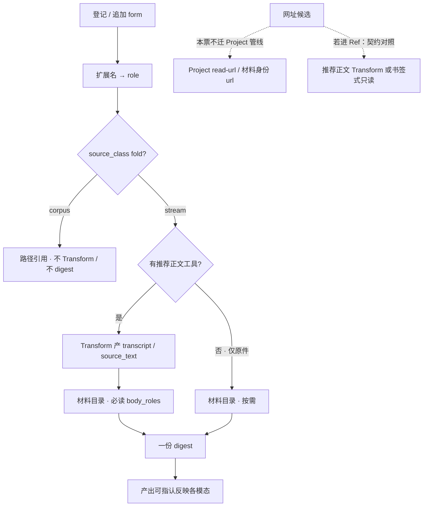

# #453 — Ref 材料元数据与类型处理契约

- Issue: [#453](https://github.com/xforce-io/kairo/issues/453)
- 版本: `453-l1-v1`
- 分支: `feat/453-material-contract`
- 状态: **L1 Approved**（peng 2026-10-24 ~17:23 Asia/Shanghai：批准 453-l1-v1；S5 默认组合 = transcript|source_text + attachment(图)）
- 日期: 2026-10-24 Asia/Shanghai
- L1: write · L2: write（见 [453-material-contract-l2.md](453-material-contract-l2.md)）
- 产品确认来源（会话口径，尚未等同文件头正式批准）：peng 2026-10-24 Asia/Shanghai 对话 — 元数据与类型处理声明化；理解交给模型；贵且稳的变换仍是工具；文件不单开「文件」模态；网址偏推荐正文 Transform 或书签式只读；验证要求 digest 支持并反映同 Ref ≥2 种模态 form。Issue 正文已收录该约定。
- 本文件是 #453 的 **L1 事实源**。Issue 只保留 Stories 摘要与本链接。

章节映射（设计合同 ↔ 本文）：§1 背景与目标 · §2 范围与非目标 · §3 用户与产品概念 · §4 产品交互总览 · §5 信息架构与入口 · §6 Stories · §7 产品规则 · §8 / L1.8 验收 · §9 折衷与开放问题。

名词沿用 [名词表](../glossary.md)：**Ref**、**digest**、**stream**、**corpus**、**transcript**、材料目录、form、**role**、**推荐正文工具**、**仅原件可读**。字段事实源仍是本 L1 §7。

## 1. 背景与目标

[#453](https://github.com/xforce-io/kairo/issues/453)。要扩展更多 Ref 输入模态（任意文件、网址等）。现网已有扩展名→role、Transform（audio→transcript、document→source_text）与 attachment 进 digest 材料目录；继续按格式硬编码专用管线难以泛化。

**可观察目标**：为 Ref 材料建立可扩展统一契约——元数据清楚、类型处理建议声明化、digest/agent 按契约消费；新增模态主要靠补契约与工具，而不是新开平行管线。验证时 digest 必须能支持并反映同一 Ref 上的多种模态 form。

既有能力对齐：[#446](446-ref-matter-package.md) / #449 事项包；[#15](15-binary-ingest.md) 二进制摄入；[#44](44-meeting-multiform-digest.md) 多形态 digest；[#67](67-dir-as-multiform-ref.md) / #357 多 forms。

## 2. 范围与非目标

### In

- Ref 材料元数据契约（字段含义：role、来源/origin、是否 fold/source_class、是否进 digest 目录、推荐正文等）可读、可对照 manifest。
- 类型处理方式声明为**建议**（推荐正文工具 vs 仅原件可读），覆盖现网音频、办公文档、图片。
- 扩展原则：文件按内容分 role；网址对照结论（推荐正文或书签式）；不要求每扩展名一套 digest 业务分支。
- 无人值守 step 仍能消费推荐正文工具（或明确 blocked）。
- digest 多模态 form 支持与反映的验证要求（S5）。

### Out

- 立刻实现全部新文件格式或通用网页抓取。
- 把 Project Data Source / `read-url` 整套迁入 Ref。
- 废除 Transform 引擎改成纯 skill 调度（另票）。
- 改 Project 模型、Ref↔Project 直连、digest「至多一份」上限（#242 / #446 硬约束仍有效）。

## 3. 用户与产品概念

| 角色 | 关系 |
|---|---|
| 产品 / 维护者 | 读契约与对照表，设计新模态时有唯一字段依据 |
| agent / 调和引擎 | 按 constitution 声明跑 Transform；按材料目录消费 forms |
| 使用者 | `add` / attach 后 `run`/`step`；看 digest 是否吃进多模态 |

概念（不堆数据结构）：

- **Ref**：一次事项的多形态资料包（#446）；若干 **form**，至多一份 **digest**。
- **role**：form 的类型槽（如 audio、document、attachment、transcript、source_text）；由扩展名映射或 Transform 派生，**不是**「文件」这一个模态。
- **推荐正文工具**：贵且稳的 Transform（如听写、抽字），产物进 `body_roles`，供 digest 必读。
- **仅原件可读**：不派生正文（如图片 attachment），进材料目录「按需」，由模型 Read。
- **stream / corpus**：观测可 fold+digest；基线只读参考、不跑 Transform/Digest（既有 source_class）。

## 4. 产品交互总览

对应 S1–S5。逐步路径见 §6。

## 5. 信息架构与入口

本票**不强制**新 Console 页或新 CLI。契约事实源是本 L1（及 L2 落点）；对照入口是既有：

| 入口 | 用户看到什么 |
|---|---|
| 设计 / glossary | 元数据字段与处理建议（S1/S2） |
| `references/<id>/manifest.yaml` | 多 forms 的 role / location / origin |
| `kairo add` / attach / 目录 add | 挂 form，不新建平行 digest 管线 |
| `kairo run` / `step`（及 Web 等价调和） | Transform → digest；blocked 可观察（S4） |
| Ref digest 正文 + 材料目录 | 多模态进入可消费集合并有反映（S5） |
| Project `read-url` | 网址现状；本票只写对照原则，不改入口归属 |

空状态：尚无多模态 form 的 Ref 不触发 S5；单 form 仍合法（形态数为 1 的事项包）。

## 6. Stories 与完整交互

沿用 Issue S1–S5，不另造编号。

### S1. 材料元数据契约可读

- 角色：产品 / 维护者
- 前置：仓库有 glossary 与现有 form/manifest
- 入口：本 L1 §7 字段表 + 一条真实多形态 Ref 的 `manifest.yaml`
- 操作：阅读 role、来源(origin)、source_class/fold、是否进 digest 目录、推荐正文等含义；对照 forms
- 成功：新模态设计有唯一名词与字段依据
- 异常：口口相传或只散落在 skill 散文 → 不合格
- 定量：契约说明覆盖 audio / document / attachment / transcript / source_text 至少各 1 条

### S2. 类型处理方式声明为建议

- 角色：维护者 / agent
- 前置：S1 契约存在
- 入口：本 L1 §7 处理建议表
- 操作：查看音频 / 办公文档 / 图片建议；确认标明「推荐正文工具」与「仅原件可读」
- 成功：建议是声明化事实源，不是唯一藏在 skill 里的散文
- 定量：三类输入各 ≥1 条建议

### S3. 新模态按契约扩展而不是平行管线

- 角色：产品
- 前置：S1/S2 就绪
- 入口：本 L1 本节对照结论（事实源在设计，不贴回 Issue 正文）
- 操作：用「文件（按内容再分）」与「网址」对照契约
- 成功：不要求为每个扩展名新建 digest 专用业务分支；统一进材料目录；派生正文可选且声明式

**对照结论 · 文件**

- 不单开「文件」模态。按内容/扩展名落入既有或新增 **role**（音频→audio、办公文档→document、图→attachment、纯文本→default_role/transcript 等）。
- 扩展：补 `roles_by_ext`（或等价声明）± 可选 Transform；DigestRule 仍只认 body_roles + attachment 目录，不写 `if ext == ...` 平行分支。

**对照结论 · 网址**

- 现状：Project 材料身份 `type=url`（`project_materials.read_url_material` / readers），与 Ref forms 分流。
- 若未来进 Ref：优先「推荐正文 Transform」（抓取/转 md 后进 body_roles）或「书签式只读」（仅登记 URL/元数据、不默认当 attachment 塞进按需目录）。
- 本票**不**把 Project read-url 迁入 Ref；不默认「网址 = attachment」。

### S4. 无人值守 step 仍能消费推荐正文工具

- 角色：使用者
- 前置：某 stream Ref 含需推荐正文工具的类型（音频或办公文档）
- 入口：登记后 `kairo step` / `run`（或 Web 等价）
- 操作：执行调和；查看是否产生推荐正文并可供 digest；失败时看 blocked 状态
- 成功：泛化后不退化成「只挂原件、从不派生」
- 异常：missing-source / no-asr / asr-failed / convert-failed 等 → 可观察 blocked，二者必居其一（有正文或明确 blocked）
- 定量：audio→transcript 与 document→source_text 路径均满足

### S5. digest 支持并反映多模态 form

- 角色：使用者 / 验收者
- 前置：一条 stream Ref 同时挂 ≥2 类不同模态 form（例：音频或其 transcript + 图片 attachment；或 document/source_text + attachment）
- 入口：step/run 完成后的 digest 与材料目录
- 操作：核对可消费集合含这些 form；读 digest 正文，各模态信息有可核对反映（引用、转述或明确依据）
- 成功：不是只消化单一正文、其余形态被静默丢掉
- 禁止：多模态进了目录但产出对某一模态零指认
- 定量：同 Ref ≥2 模态 form 均进入 digest 可消费集合；每种至少 1 处可指认反映

## 7. 产品规则与边界

### R1 元数据字段（契约核心）

| 字段 | 含义 | 谁写 |
|---|---|---|
| role | form 类型槽；决定 Transform 消费/产出与 digest 目录必读/按需 | 摄入 guess 或 Transform 追加 |
| location / hash / origin | 路径、内容指纹、来源标记（added / backend-from:…） | 摄入 / Transform |
| source_class（manifest `class`） | stream 可消化；corpus 基线不 Transform、不 digest | 摄入时归类 |
| body_roles | digest **必读**正文 role 优先序（现网 transcript、source_text） | constitution |
| transforms | 推荐正文工具声明：consumes → produces via backend | constitution |
| attachment 进目录 | role=attachment → 材料目录「按需」，不进 body 拼接 | DigestRule 固定分流 |

### R2 处理建议（声明，非散文唯一源）

| 类型 | 建议 | 类别 |
|---|---|---|
| 音频（audio） | 先经推荐正文工具听写 → transcript，再 digest | 推荐正文工具 |
| 办公文档（document） | 先抽字 → source_text，再 digest | 推荐正文工具 |
| 图片（attachment） | 不强制抽字；原件进材料目录按需 Read | 仅原件可读 |

理解（摘要、判断、跨模态综合）交给模型；贵且稳的变换留在工具（Transform），不把每种格式写成业务 if 分支。

### R3 扩展与分流

- 新扩展名：优先映射 role ± 可选 Transform；禁止平行 digest 管线。
- 文件：按内容分 role（R2），禁止「文件」单一模态。
- 网址：见 S3 对照；与 Project URL 管线并存，本票不合并实现。
- 一条 Ref 仍至多一份 digest；多模态共享这一份。

### R4 失败可见

推荐正文工具失败必须留下可观察 blocked（或等价状态），不得静默「仅原件且假装已消化完成」。

## 8. 验收与效果验证（L1.8）

设计版本：`453-l1-v1`。下表只定标准，不记本次执行 pass。用户可见项须在实现后由 verify 功能文件取证（L2 点名映射）。

| ID / 关联 | 前置 | 入口与操作 | 可判定结果与禁止 | 证据 / 执行 / 属性 |
|---|---|---|---|---|
| S1.A1 / S1 / R1 | 仓库含本 L1 与至少一条多形态 Ref | 读 §7 字段表；打开该 Ref `manifest.yaml` 对照 forms | 五类 role（audio/document/attachment/transcript/source_text）在契约中各有说明；manifest 字段能对上号；禁止仅靠口头 | 设计原文 + manifest 摘录；人读可判定；必需 |
| S2.A1 / S2 / R2 | S1.A1 契约存在 | 读 §7 处理建议表 | 音频、办公文档、图片三类均区分「推荐正文工具」与「仅原件可读」；禁止建议只存在于 skill 散文 | 设计原文；人读；必需 |
| S3.A1 / S3 / R3 | S1/S2 就绪 | 读 §6 S3 两段对照结论 | 文件：按内容分 role、不单开文件模态；网址：推荐正文或书签式、不默认 attachment、不要求迁 Project 管线；禁止「每扩展名一条 digest 分支」 | 设计原文；人读；必需 |
| S4.A1 / S4 / R4 | stream Ref 含 audio 或 document；机器可跑 step（或 stub 策略按测例） | `kairo step`/`run` 或 Web 等价 | 得可用 transcript/source_text，或 products 上明确 blocked；禁止只挂原件且无状态 | CLI/状态 JSON 或 Web 任务结果；agent 可执行；必需 |
| S5.A1 / S5 | 同 Ref ≥2 模态 form（正文类 + attachment 或两类正文） | 跑完 digest；查材料目录与 digest 正文 | 各模态 form 均在可消费集合；正文对每种至少 1 处可指认反映；禁止静默丢掉某一模态 | 材料目录快照 + digest 摘录；verify 真路径；必需 |

汇总：Issue S1–S5 全部必需子项 pass 才算故事完成。S1–S3 可以在实现前用设计事实源人读；S4–S5 须运行时证据。

## 9. 折衷与开放问题

### 折衷

- 保留 Transform 引擎作推荐正文工具，而不是本票改成纯 skill 调度（Out）。
- 网址不强制迁入 Ref：先契约对照，避免两套材料身份纠缠。
- 图片保持按需 Read，不在本票引入必选 OCR 管线。

### 开放问题（实现前建议拍板）

1. **正式批准**：**已解决** — peng 2026-10-24 ~17:23 Asia/Shanghai 批准 `453-l1-v1` 作产品基线并继续端到端。
2. **glossary**：**已解决（实现）** — 名词表补了「role / 推荐正文工具 / 仅原件可读」三行；字段事实源仍是本 L1 §7。
3. **S5 最小模态组合**：**已解决** — 默认「正文类（transcript|source_text）+ attachment(图)」即可；本票不强制双正文组合。

不影响主路径的探索（通用网页抓取、新二进制格式）不在本票实现范围。

## 关联

- Issue [#453](https://github.com/xforce-io/kairo/issues/453)
- L2 [453-material-contract-l2.md](453-material-contract-l2.md)
- how：`/tmp/kairo-verify/453/how.md`
- [#446](446-ref-matter-package.md)、[#15](15-binary-ingest.md)、[#44](44-meeting-multiform-digest.md)、[#67](67-dir-as-multiform-ref.md)、#357、#449
